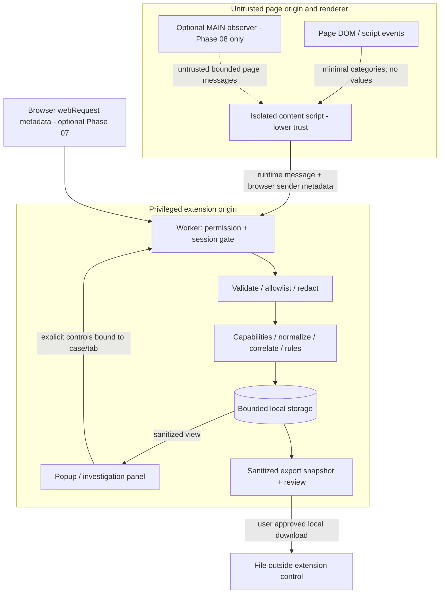

# Architecture — Phase 01

Date: **2026-10-21 (Africa/Cairo)**. **PROVISIONAL — pending owner acceptance; NOT IMPLEMENTED**. Design requirements below are future contracts, not working features. Accepted progress 1/22. [Security policy](SECURITY_PRIVACY.md) defines sensitive choices; [ADRs](02_ARCHITECTURE_DECISIONS.md) distinguish accepted sequencing from proposed engineering choices.

## Components and ownership

| Component | Responsibility / boundary | Phase |
|---|---|---|
| Extension popup | Permission explanation, selected tab/site, explicit start/pause/stop/delete, badge state; closing popup never grants consent | 02 inert shell, 03 consent |
| Investigation panel | Packaged extension UI for timeline/notes, gaps and export review; receives sanitized case views, never page DOM HTML; bind each control to displayed case/tab | 14–15; proposed side panel, full extension page alternative |
| Isolated content script | Programmatic top-frame injection after start; minimal action categories/navigation, eligible error categories; no page values/labels/selectors or injected product UI | 05–06 |
| MV3 service worker | Sole authority for session/permission checks and evidence writes; bounded validation/redaction, durable transactions, state/revocation, capability selection | 03–04 onward |
| Normalizer / correlator / rules | Pure deterministic transformations; IDs/provenance/gaps, conservative ambiguity, evidence-linked checks; no backend inference as fact | 11–13 |
| Capability adapters | Small version-independent interface, tested Odoo-specific enhancements and generic fallback; no privileged probes | 09–10, legacy 18 |
| Storage | IndexedDB proposed for sanitized cases/events; chrome.storage.local for small settings, session area for ephemeral binding; worker owns evidence writes | 04; policy pending |
| Export | One sanitized snapshot → JSON + escaped Markdown; preview/exclusions/redaction report, deliberate local download, no transmission | 15 |
| Optional MAIN observer | Untrusted, reversible fetch/XHR/error observation only after explicit Phase 08 safety GO/NO-GO; absent before then | 08 deferred |

Strict TypeScript is the blueprint direction; schema validator library remains a pinned-dependency decision in 02/11 (Zod candidate, no extra messaging abstraction required). Boundary validation starts with the first message in 03; 11 formalizes the versioned evidence schema, rather than postponing validation until 11.

## Trust boundaries and data flow



No page message can start a recording, change permissions, read another case, export, delete or cause network access. Page and content-script signals are claims from a lower-trust context; browser metadata improves source attribution, not page truthfulness. Files leave the extension retention boundary. There is no backend/telemetry/AI/Plemo transport or API contract; stable reviewed export is the only future interoperability seam (optional discovery 21).

```mermaid
sequenceDiagram
  actor U as User
  participant UI as Extension UI
  participant W as Worker gate
  participant C as Isolated script
  participant S as Local storage
  U->>UI: Select tab/site; Start
  UI->>W: Start request bound to selected tab
  W->>W: Check browser grant + origin + policy + explicit consent
  W->>C: Inject top frame; handshake document identity
  W->>W: Mint fresh session epoch and short collection lease
  C->>W: Sanitized bounded event + epoch/sequence
  W->>W: Verify sender, lease, state; normalize/redact
  W->>S: Atomic bounded append
  U->>UI: Stop / revoke / delete
  UI->>W: Invalidate epoch before teardown
  W->>C: Stop; detach; discard buffers
  W->>S: Close session or delete transaction
  Note over W,C: Restart or lost lease means paused; explicit Resume required
```

## Message and identity contract

Use runtime messages for extension traffic; do not declare `externally_connectable` or external listeners. Proposal: plain bounded JSON envelope containing protocol version, enum message kind, session ID, epoch, source sequence and allowlisted event payload. Reject unknown keys, nesting, non-finite values, types, unsupported versions and oversized strings/arrays before expensive normalization; rate limits in [security](SECURITY_PRIVACY.md). Never spread untrusted objects into configuration or merge prototype keys.

Worker validation order on every event/control:

1. Recheck permission and initialized policy; hydrate storage before admitting any event. A surviving browser grant is not consent.
2. For content messages require `sender.id` equal extension ID, browser-provided `sender.tab.id`, `frameId == 0`, non-opaque sender origin/URL and `documentId` matching the bound live document. Never trust payload tab/origin/frame. Missing identity → reject; no wildcard fallback. Parse exact URL origin (scheme, host, port), not prefix/substring. Reject restricted schemes, incognito, child frames and related about/blob/data frames in the proposed first scope.
3. Match session + current epoch, state recording, current short lease, expected document, sequence monotonicity, size/rate bounds. IDs/nonces reduce replay but cannot authenticate a malicious page. Worker assigns persisted sequence/time; page time is only a bounded source hint. Late/replayed events after pause/delete are dropped, not attached to a new session.
4. Extension controls require sender URL under this extension's known packaged UI paths with no content-script tab sender; derive target case/tab from worker registry, check current binding and request revision. Do not act on whichever browser tab happens to be focused after the click. UI must visibly identify target and reject stale controls.
5. Browser network events use browser `tabId`, frame/document and initiator/destination identity, match bound origin and recording epoch; require attributable same-origin top-frame traffic only. Missing identity/unpermitted initiator means a gap, never a new host grant.

Phase 08 page bridge, if approved: `postMessage` with exact `targetOrigin`; isolated receiver checks `event.source === window`, exact `event.origin`, protocol kind/namespace, schema/limits and current epoch; no wildcard acceptance, command channel, secrets or case data returned to page. Namespace/nonce are not an authentication boundary because same-origin page code can forge messages. Worker repeats validation/redaction. A malicious page can still falsify evidence; label source `page_untrusted` and never turn page claims into privileged commands.

## Consent, lifecycle and bounded writes

States: idle → permission_pending → recording → paused/stopped/error. Start requires explicit UI action for one tab/exact origin; recording default OFF. One active recording globally is proposed to simplify leaks/races; stored cases remain separate. Pause invalidates epoch and lease, stops observation/listeners and discards pending queues. Resume always requires explicit action and identity revalidation. Stop closes collection; delete additionally removes retained case content.

Full navigation/reload, BFCache restoration, origin change, tab close, permission removal, extension update/disable or browser restart invalidates active collection. Conservative proposal: pause even on same-origin full-document changes; SPA same-document navigation may continue after gate checks. No persistent/all-frame content registration. Already injected scripts require teardown; unregistering alone does not undo injection (S2). If acknowledgement fails, worker rejects all events and shows capture error; short local leases expire collectors. A compromised page is outside the control guarantee.

Worker globals are disposable (S4). Top-level listeners hydrate state through a serialized initialization gate; fresh worker epoch invalidates all prior leases, recovers cases as paused and admits no queued old events. Collectors check a short lease before reading even eligible fields; worker death cannot be detected instantaneously, so a bounded lease expiry is the fallback, not a promise of immediate remote teardown. No keepalive workaround or full raw-event queue. Restart gaps are visible and explicit Resume is required. Persisted consent does not auto-start collection.

Worker serializes append/delete/state operations with transactions and a deletion generation: recheck epoch before commit, remove stale aggregates/findings/indexes with events, reject stale export snapshots and late writes. Quota/disk error or cap → stop capture, report gap, no unbounded retries. Expiry is enforced before read/write/export and on wake; closed-browser cleanup cannot run on a wall-clock deadline. Numeric limits and encryption are unapproved proposals, not defaults in code.

## Adapter capability model and safe degradation

Each adapter declares its ID/revision, applicable observed capabilities, safely accepted input categories, output categories, provenance reference and limitations. Selection uses capabilities first, claimed version second. No adapter can request permission, invoke RPC, fetch URLs, inject code, write records or inspect arbitrary bodies. Normalizer rejects unsupported fields regardless of adapter.

A per-session capability entry records feature, availability/reason, source and confidence, adapter ID/revision, safe evidence IDs and fixture/real-test provenance. Keep detection confidence (`reported`, `inferred`, `unknown`; exact verified evidence only when justified) separate from support status (`Verified`, `Partial`, `Fallback`, `Unknown`, `Unsupported`). Current feature support for every Odoo 8–20 row remains UNKNOWN / NOT TESTED in [support matrix](SUPPORT_MATRIX.md).

Generic baseline can retain eligible action/navigation categories and manual notes, plus only actually observable errors/request metadata. Isolated JS does not grant access to all page errors or internals. Denied webRequest/MAIN/CSP/unknown clients → feature unavailable with reason, manual steps and reduced handover; no permission escalation or universal route hook. Unknown route becomes a category `unknown`, not a retained raw URL. RPC model/method/envelope errors remain absent without safely observed signals. HTTP 200 is transport evidence; application success remains unknown. Reliable browser request IDs can join metadata; temporal action joins remain heuristic with unmatched events preserved. Missing signal is not evidence of success or failure.

Cases retain evidence ID, source kind/trust, schema/tool/adapter version, observed/derived/user-stated/unavailable/hypothesis, capture mode, redaction/drop/gap reasons and evidence links. Derived findings reference actual IDs and algorithm/rule revision. No hidden cross-case join; comparison 17 uses only shared capabilities after the single-case MVP 16. No certification from synthetic fixtures or version labels.

## Framework/build comparison — current official evidence

Checked **2026-10-21**; source support is not an installed build test or dependency audit. Options below are engineering judgments derived from the cited docs.

| Candidate | Verified official capability | Fit / cost and permission risk | Disposition |
|---|---|---|---|
| WXT + React UI | Generated manifests; official React module; upstream metadata 0.21.4, Node >=22 and Bun >=1.2.0 declarations (S10–S12) | Fits separate entrypoints; inspect generated manifests because development adds permissions and panel entrypoints affect manifest. More tooling dependencies than manual MV3 | Recommended, PROPOSED P01-BUILD; strict TS, React only packaged UI |
| Native MV3 + Vite, React or plain UI | Chrome defines worker/scripts; Vite builds assets; React docs describe Vite as an option (S1–S4, S13–S14) | Explicit manifest and fewer extension conventions; team must wire worker/content outputs, reload and packaging correctly | Viable fallback if WXT permissions/output unsuitable; no claim of inherently greater security |
| Plasmo + React | Official SDK documents TS/React, extension entrypoints and multi-manifest/browser targeting (S15) | Relevant batteries included; abstractions still need manifest/data-flow audit; hosted build/deploy features unnecessary | Alternative; not chosen, no assertion of vulnerability or poor maintenance |

No React in Odoo DOM, no SSR/router/global state library/backend/analytics needed for this scope. React is a UI library, not a permission boundary. Proposed Phase 02 evaluation must pin actual compatible releases and Node/package manager from package metadata/lockfile, review transitive dependencies and development versus production manifests, packaged code/CSP and reproducible output; do not reuse moving main-branch engine declarations as final prerequisites. No installation/scaffolding now. Test-tool direction remains Vitest/Playwright from blueprint, uninstalled/unverified.

Browser proposal: API floor Chrome 120 to simplify modern MV3 behavior; sidePanel itself is documented at 114+ and document targeting at 106+ (S2/S8), so 120 is a conservative product proposal, not a derived universal API minimum. Support only a currently patched Stable build initially on Linux, record exact build/OS later; no security promise for obsolete 120. Owner/QA must approve floor, generated build target and coverage; other Chromium/OS/Firefox remain untested.

## Official source register

All retrieved **2026-10-21**. Web open/find used except S4 recovered via Python urllib HTTP 200 after web timeout; relevant lifecycle/IndexedDB text inspected. Dated retrieval means source reviewed, not runtime verified. URLs below support platform facts; product policies above remain proposals.

| ID | Official reference | Fact used |
|---|---|---|
| S1 | [Chrome content scripts](https://developer.chrome.com/docs/extensions/develop/concepts/content-scripts) | Isolation, shared DOM, MAIN/page CSP |
| S2 | [Chrome scripting](https://developer.chrome.com/docs/extensions/reference/api/scripting) | Target tab/frame/document, worlds, injection teardown limits |
| S3 | [Chrome activeTab](https://developer.chrome.com/docs/extensions/develop/concepts/activeTab), [permissions](https://developer.chrome.com/docs/extensions/reference/api/permissions), [match patterns](https://developer.chrome.com/docs/extensions/develop/concepts/match-patterns) | Temporary grants versus optional grants; grant scope differs from application session |
| S4 | [Worker lifecycle](https://developer.chrome.com/docs/extensions/develop/concepts/service-workers/lifecycle) | Suspension, lost globals, persistence choices |
| S5 | [Chrome messaging](https://developer.chrome.com/docs/extensions/develop/concepts/messaging) | Runtime messages, lower-trust content input, XSS precautions |
| S6 | [Chrome storage](https://developer.chrome.com/docs/extensions/reference/api/storage) | Local/session distinction, quotas/access-level restrictions |
| S7 | [Chrome webRequest](https://developer.chrome.com/docs/extensions/reference/api/webRequest) | Metadata, initiator/destination host access, IDs; no general response-body reader |
| S8 | [Chrome sidePanel](https://developer.chrome.com/docs/extensions/reference/api/sidePanel) | Packaged persistent UI, permission and API version |
| S9 | [Chrome CSP](https://developer.chrome.com/docs/extensions/reference/manifest/content-security-policy) | Packaged scripts and extension policy constraints |
| S10 | [WXT manifest](https://wxt.dev/guide/essentials/config/manifest.html) | Generated manifest, dev permission additions |
| S11 | [WXT frontend modules](https://wxt.dev/guide/essentials/frontend-frameworks.html) | React module available |
| S12 | [WXT maintainer metadata](https://raw.githubusercontent.com/wxt-dev/wxt/main/packages/wxt/package.json) | Current upstream version/engine declarations; moving main, not a pin |
| S13 | [Vite guide](https://vite.dev/guide/) | General build/dev tooling; extension wiring remains project work |
| S14 | [React from scratch](https://react.dev/learn/build-a-react-app-from-scratch) | Build-tool options and client UI tradeoffs |
| S15 | [Plasmo framework](https://docs.plasmo.com/framework) | React/TS and extension targets |

## Future verification gates

03 consent/messages and permissions; 04 lifecycle/retention/delete/restart; 05–07 minimal signals; 08 CSP/collision/body safety GO/NO-GO; 09–11 capability/schema provenance; 12–13 conservative findings; 14–15 accessible UI/review/export; 16 single-case acceptance; 17 comparison; 18 legacy evidence; 19 security/performance resilience; 20 release review; 21 optional separate discovery. [Threat tests](SECURITY_PRIVACY.md) define expected negative cases. Runtime/browser/Odoo: **NOT TESTED**. Architecture approval and policy decisions require owner review; this document grants no access.
